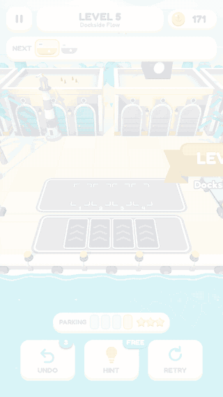
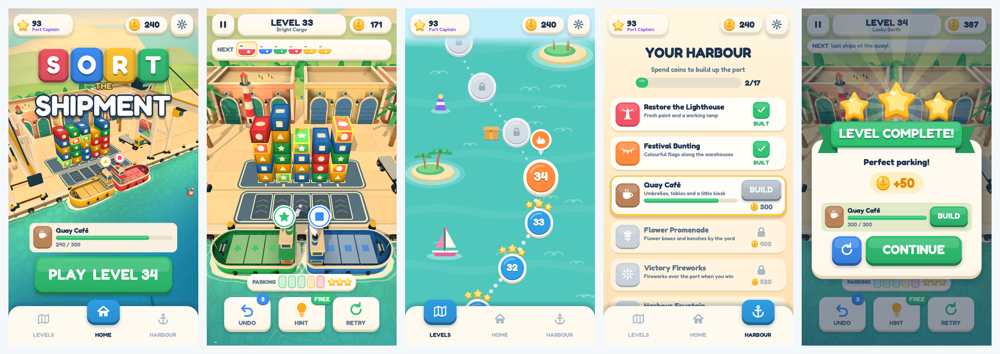
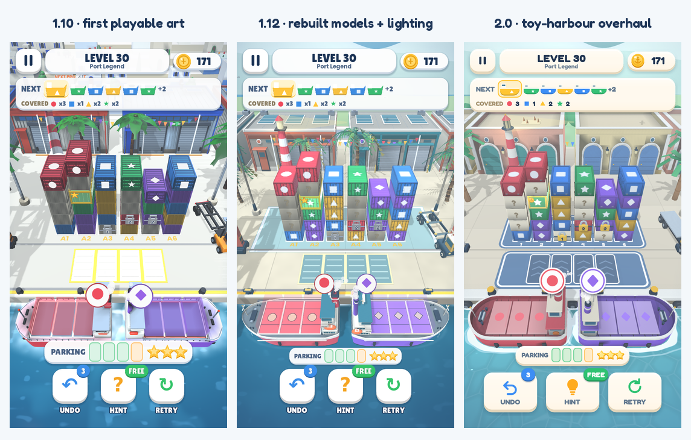

# Sort the Shipment

[](https://github.com/ImadC9/sort-the-shipment/actions/workflows/tests.yml)

A 3D harbour puzzle game about making room and planning the next shipment. Tap a
stack to move its top container onto a matching ship, or into a small parking
area. Fill the ships before the yard jams.

<p align="center">
  
</p>

**[Play in your browser on itch.io](https://imadch.itch.io/sort-the-shipment)** ·
**[Read the case study](docs/case-study.md)**



## The game

- **100 levels in 10 chapters:** a designed 20-level opening followed by generated
  puzzles, with covered cargo, padlocks, gold cargo and changing harbour lighting.
- **One tap, several consequences:** expose the right container, preserve parking
  space and set up a chain that sends several ships away.
- **A reason to replay:** earn up to three stars by limiting peak parking use;
  collect coins, advance through 12 ranks and build 17 cosmetic harbour projects.
- **Help when needed:** undo, solver-backed hints, an extra parking spot and
  locally saved progress, including mid-level resume.

## Release status

| Platform | Status |
|---|---|
| Web | Published on itch.io; play using the link above. |
| Android | Export presets and a signing workflow are included. Not published on Google Play. Ads use test IDs; production configuration and current device validation remain release steps. |

The repository is configured as version **2.0.0**. Development used AI assistance
for implementation and selected creative materials; the [case study](docs/case-study.md#4-ai-assisted-development)
explains my role, decisions and review process.

## Run locally

1. Install [Godot](https://godotengine.org/download) **4.5.2**, matching the build workflows.
2. Import `project.godot`, allow the assets to import, then press **Play**.

Models, sounds and the level pack are included. Blender is needed only to rebuild
models from the Python scripts.

## How it is built

| Area | Implementation |
|---|---|
| Engine | Godot 4.5.2, GDScript, GL Compatibility renderer |
| Rules and presentation | A visual-free rules model emits events for the 3D world |
| Puzzles | Level generator, search-based solver and stored solutions |
| Art and audio | Scripted Blender models, procedural shaders, generated audio and credited third-party effects |
| Android | GitHub Actions signing workflow; AdMob and UMP consent integration |

Nine automated checks are configured for pushes to `main`, pull requests and
manual runs. They cover stored three-star solutions, rules, interface, exploit
regressions, simulated ads, tap picking, level transitions, opening variants and
ship departures. They complement device testing and human playtesting.

Example commands, run from the project folder:

```bash
godot --headless --path . -- --verify
godot --path . -- --bugtest
godot --path . -- --uitest
```

See the [developer guide](docs/DEVELOPMENT.md) for the full workflow, Android setup
and asset generation, and the [case study](docs/case-study.md#5-validation-and-its-limits)
for the scope of the recorded validation.

## Visual evolution



The [changelog](CHANGELOG.md) records the releases and visual changes.

## Licence

Source code: MIT. Game content, including the name, levels, artwork, models and
original audio: all rights reserved. Third-party components retain their own
licences. See [LICENSE](LICENSE) and [THIRD_PARTY_NOTICES.md](THIRD_PARTY_NOTICES.md).
