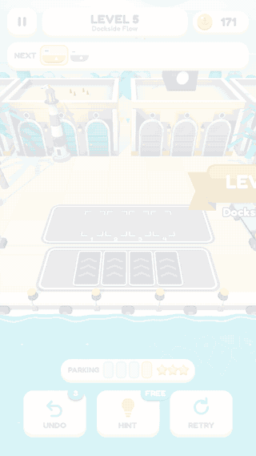
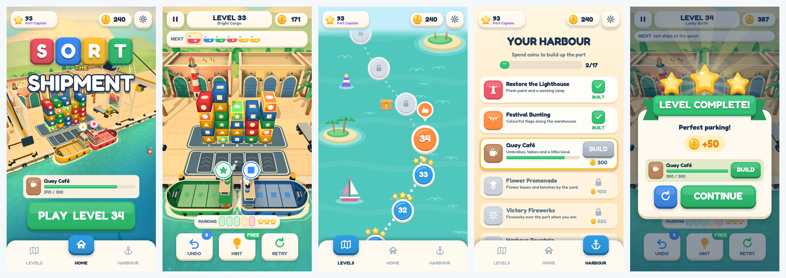
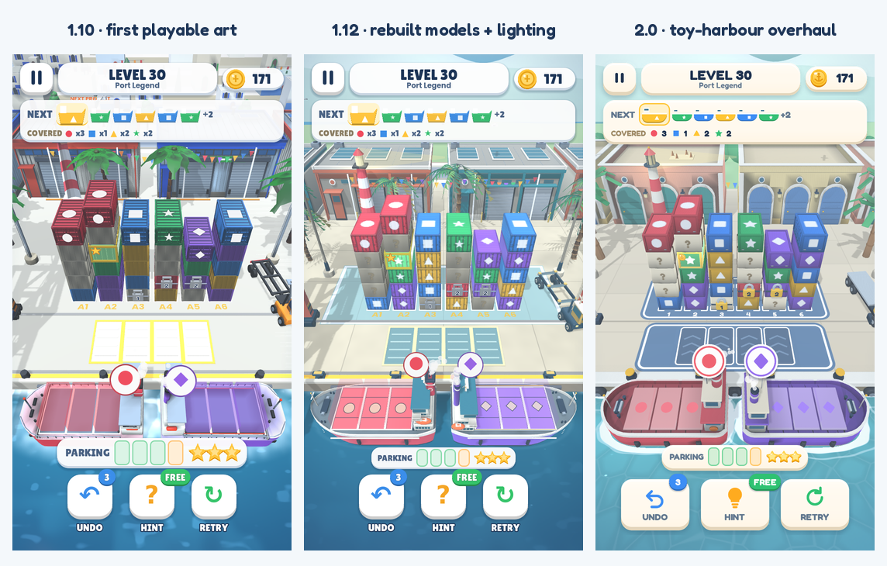
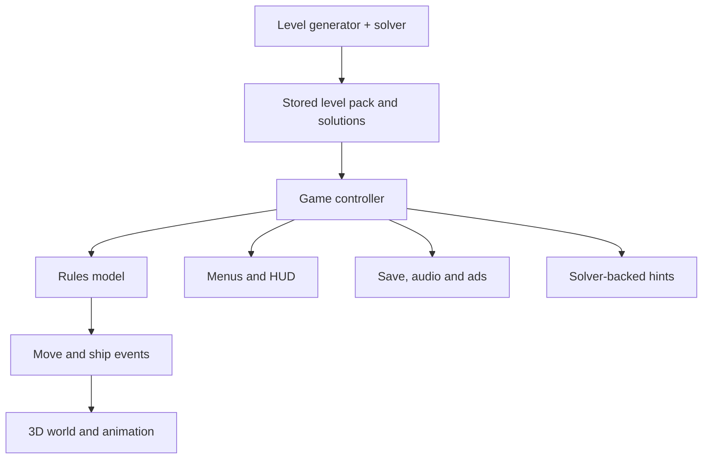

# Sort the Shipment: from simple rules to a playable harbour

**[Play on itch.io](https://imadch.itch.io/sort-the-shipment)** ·
**[Explore the project](../README.md)**

## At a glance

I created a harbour sorting puzzle around one decision: **which container should
move next?** The game grew into a 100-level campaign with a public browser release,
a progression loop and an Android build pipeline.

My role combined product ownership, game design, art direction and the direction
and review of AI-assisted implementation. The central challenge was to add depth
and a distinctive setting while keeping the player's input simple.

| | |
|---|---|
| Role | Solo creator and product owner, working with an AI coding agent |
| Timeline | November 2026; web release on 10 November; version 2.0 recorded on 11 November |
| Stack | Godot 4.5.2, GDScript, Blender/Python tooling, GitHub Actions, AdMob |
| Delivered | Browser game, 100-level pack, local progression, scripted art pipeline and Android export workflows |
| Android status | Build configuration included; Google Play publication and current physical-device validation remain outstanding |

## 1. The product problem

I wanted a puzzle that could be understood through a few taps, then sustain
planning without adding more controls. The harbour setting made the rules
concrete: containers belong on matching ships, parking is limited, and clearing a
ship creates the next opportunity.

Three rules carry the experience:

1. Only the top container in a stack can move.
2. It loads onto a matching docked ship when space is available.
3. Otherwise, it uses parking until a matching ship arrives.

The design goal was readable cause and effect. A player should be able to connect
a tap to a container moving, a parking space opening or a ship departing.

## 2. Decisions that shaped the game

### Use the same constraint for survival and scoring

Parking creates pressure and determines the star rating. The lower the peak
number of parked containers, the better the score. A gauge makes that cost
visible during play.

This gives players a clear reason to replay a solved level without introducing a
timer or a separate move target. The trade-off is that the gauge and thresholds
must be easy to read; a solvable puzzle alone does not establish that players
understand the scoring.

### Teach a decision before combining it with others

The first 20 levels are explicitly authored. Matching and parking come first,
then dispatch chains and planning. Covered cargo arrives at level 13 and locks at
level 16, with simpler levels between harder ideas.

The rest of the campaign uses chapter-based generation with constraints for
colours, stacks, parking and special cargo. Simulated random-play clear rates
help compare layouts, but they are tuning signals rather than measurements of
human difficulty. The transition into levels 21–23 was revised to soften the jump
from the new opening into the generated campaign.

Chains provide a satisfying result from a well-chosen tap. They are available in
many levels, while levels 4, 6 and 7 focus on other lessons and are not marked as
chain-capable in the stored pack. The goal is a paced introduction, not a
requirement to perform a chain in every puzzle.

### Make progression visible in the place where players work

Stars raise the port rank, while coins fund 17 cosmetic harbour projects: a
restored lighthouse, a quay café, lights and other additions. The setting changes
as players progress, giving rewards a visible purpose beyond a counter.

These upgrades do not change the sorting rules. That choice keeps the campaign's
core constraint consistent while adding longer-term goals. Whether the projects
improve replay or retention remains a question for player observation and data.

### Give the puzzle visual priority

The art evolved from a more detailed port into a sunny toy harbour with rounded
models, strong cargo colours and a quieter background.

One iteration focused on the town behind the warehouses. Adding detail did not
resolve the clutter, so I chose soft layered hills instead. Reviewing the result
also exposed misplaced café and fountain elements, which moved to the promenade.
The useful decision was choosing what deserved attention: containers and ships
carry the puzzle, while the backdrop establishes the setting.

## 3. Technical implementation

### Separate game state from what the player sees

The [rules model](../scripts/game_model.gd) owns stacks, parking and ships without
rendering them. The [controller](../scripts/main.gd) coordinates the level, rewards
and interface; the [world](../scripts/world.gd) turns events into visible actions.

The [solver](../scripts/solver.gd) searches a compact representation of the state.
It has its own transition implementation, so agreement with the game model must
be checked. The level verification harness replays stored solutions through the
actual game model and checks the resulting star rating. This provides a way to
check generation output against gameplay.

### Handle transitions as a lifecycle problem

Earlier development reports described crashes after winning and continuing on a
phone. The fixes addressed animations outliving their screens and callbacks from
an old attempt arriving during the next one.

The implementation uses attempt IDs to reject stale callbacks, attaches
animations to the screen they affect and checks node validity before delayed
updates. A back-to-back level mode exercises win → Continue repeatedly. The
lesson was to make ownership and cancellation explicit whenever visual work can
outlive the action that started it.

Source: [controller](../scripts/main.gd), [HUD](../scripts/hud.gd),
[interface helpers](../scripts/icons.gd) and [development harness](../scripts/dev_harness.gd).

### Design for touch, then check the actual device

Another reported Android issue was a settings switch that appeared not to move.
Touch input and an emulated mouse click could toggle it twice. The interface
handles one input path with a debounce and makes the entire row tappable.

An automated interface check can protect the intended response, while device
testing is needed to discover how the platform delivers the interaction.

### Build assets and exports through repeatable tooling

Python scripts in [the Blender tools](../tools/blender/) generate the models.
Shared materials, simplified geometry and merged distant scenery help control
rendering cost as the harbour becomes richer. Draw-call and triangle counts are
useful engineering measures; they do not establish frame rate on a particular
phone without a device measurement.

The [Android workflow](../.github/workflows/android-aab.yml) is configured to build
a signed app bundle and installable APK, using credentials supplied through
GitHub secrets. It targets API 36 and includes bundle validation and an arm64
native-library alignment check. These are build checks, not a guarantee of store
approval or complete platform compatibility.

The source package keeps AdMob in test mode with blank live unit IDs. Production
advertising configuration, consent setup and release-device checks are separate
steps before a store release.

## 4. AI-assisted development

AI assistance was part of the implementation process, including code, Blender
scripts, automated checks and selected creative and publishing materials. My
responsibility was to define the player experience, set constraints, choose
directions and review what the implementation actually delivered.

The working cycle was:

1. **Describe the outcome in player terms:** what should happen, what felt wrong
   and which rules or saved data needed to remain stable.
2. **Request a bounded implementation:** a feature, fix or visual direction with
   a build and screenshots for review.
3. **Review behaviour and presentation:** inspect the result, play available
   builds and report concrete problems rather than accept the generated summary.
4. **Use regression checks and iterate:** turn recurring failures into checks and
   revisit the design when repeated small changes did not solve the problem.

Earlier Android iterations informed feedback on transitions, switches, loading
and sound. That history does not establish that every later revision was tested
on a phone; the V3 validation record explicitly notes that no updated APK or
physical-phone performance check had been completed.

One documented tooling failure was a test summary that always printed “ALL OK”:
a counter updated inside a lambda did not update the outer value. The correction
used shared counters and failure exit codes. The broader lesson was that generated
tests also need review, including evidence that a failing check can fail the run.

## 5. Validation and its limits

The repository includes nine automated checks. The
[Tests workflow](../.github/workflows/tests.yml) schedules them on pushes to
`main`, pull requests and manual runs, and uploads logs from the run.

| Check | Scope |
|---|---|
| Stored solutions | Replay each level's solution through the game model and check three stars |
| Rules regressions | Attempts, undo refunds, extra spots, resume and hints |
| Interface | Menu navigation, pause, back handling and switches |
| Exploit regressions | Undo coin farming and stale resume data |
| Simulated ads | Placement, pacing and reward paths without a live ad service |
| Tap picking | Match screen taps to the intended stack |
| Back-to-back play | Repeated level transitions, with memory and animation logging |
| Opening variants | Replay eight stored hidden-colour cases across four opening levels |
| Ship departures | Timing, undo/restart during departure and reduced motion |

The [recorded V3 validation summary](design/Validation.json) reports 100 stored
three-star solutions, eight covered-colour variants and zero failures across 30
monitored dispatch launch events. These are recorded development results, not a
new validation of every subsequent version.

The scope matters:

- A three-star solution establishes a route through a layout. It does not prove
  that the puzzle is intuitive, enjoyable or appropriately difficult.
- The opening check replays a separate stored solution for each variant. Although
  the design notes describe a strategy based on visible information, the included
  verifier does not independently establish that property.
- Later generated covered-cargo layouts use sampled hidden-colour shuffles;
  they are not exhaustively checked against every possible arrangement.
- Desktop ad simulation does not validate live SDK delivery or consent behaviour
  on a release device.
- The V3 record notes no updated APK, no physical-phone performance measurement
  and no human difficulty study. Current device and player validation remain open.

## 6. Outcome and next decisions

The delivered project combines a public browser game, a 100-level campaign,
stars and harbour progression, local saves, a scripted asset pipeline and
automated regression tooling. The [changelog](../CHANGELOG.md) records the
iterations through version 2.0. Android remains a release workstream rather than
a published platform.

The result is a complete playable loop with a clear design constraint and
inspectable implementation. The next evidence should come from people using
it: observe new players through the early lessons, identify where parking and
chains become confusing, and measure performance on representative Android
phones. Those observations should guide difficulty and polish before expanding
the feature set.

The project reinforced three habits: keep the main interaction simple, give
visual feedback a clear direction, and define completion with evidence that
matches the claim. AI accelerated implementation; deciding what to build and
checking what it meant for the player remained my responsibility.

---

**[Play Sort the Shipment](https://imadch.itch.io/sort-the-shipment)**
